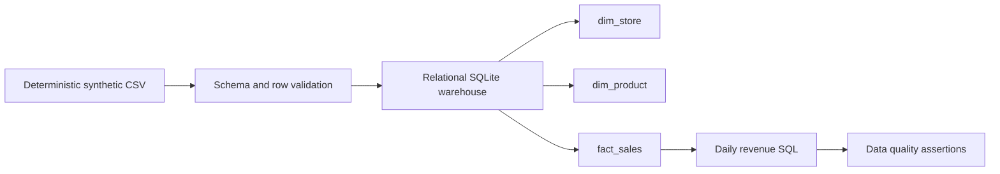

# Architecture and engineering decisions

The warehouse is rebuilt in a deliberately disposable local SQLite file. This is **not** a live production pipeline or incremental ELT implementation.

## Data contract and constraints

Source columns are `transaction_id`, `sold_date`, `store_id`, `product_id`, `quantity`, and `unit_price_cents`. All fields must be present. Dates must parse as ISO dates; quantities must be positive whole numbers; integer cent prices must be nonnegative. Duplicate transaction IDs reject the entire batch. The fact table uses foreign keys referencing two dimensions.

## Verification

The `sql/data_quality.sql` query returns record count, total monetary cents, invalid foreign key count, and count of bad quantities or prices. Tests assert that warehouse aggregates equal independently computed source totals. GitHub Actions uploads the actual validation report from a synthetic batch.

## Production next steps (not implemented)

- Durable staging tables, orchestration and incremental watermarking
- Versioned schema contracts and rejected-record DLQ
- Idempotent ingestion and robust replay/backfill behavior
- Metrics on data freshness, rejected rows, source-to-target reconciliation and availability
- PostgreSQL or cloud warehouse deployment with least-privilege credentials and safe migrations

The demonstration does not claim production scale, reliability SLOs or measured business impact.
